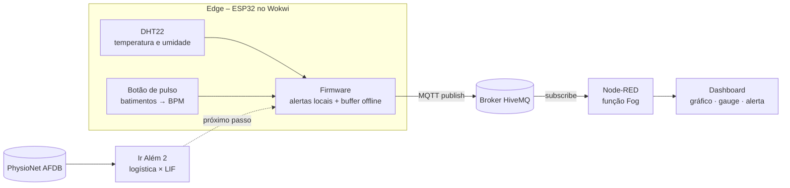

# FIAP - Faculdade de Informática e Administração Paulista

<p align="center">
<a href= "https://www.fiap.com.br/"></a>
</p>

<br>

# CardioIA – Fase 3: Monitoramento Contínuo com IoT na Saúde

## Nome do grupo

*(nome do grupo)*

## 👨‍🎓 Integrantes: 
- Filipe Augusto Lima Silva
- Laísa Cristina Capodifoglio Andrade
- Johnathan da Cruz Gatti
- Diogo Ferreira Pereira
- André Victor Gonçalves Toledo

## 👩‍🏫 Professores:
### Tutor(a) 
- Leonardo Ruiz Orabona
### Coordenador(a)
- André Godoi Chiovato


## 📜 Descrição

Nesta fase, o CardioIA ganha um protótipo de **wearable cardíaco** que percorre o ciclo completo de dados em IoT aplicado à saúde: **captura → processamento local → transmissão → visualização → alerta**. A solução foi desenvolvida em três entregas.



**Parte 1 – Armazenamento e processamento local (Edge Computing)** · [simulação no Wokwi](https://wokwi.com/projects/479719847288354817)

Um ESP32 lê dois sensores: o **DHT22** (temperatura e umidade) e um **botão de pulso**, em que cada clique representa um batimento e o firmware calcula o BPM. Cada leitura é classificada no próprio dispositivo (febre, hipotermia, taquicardia, bradicardia, ausência de pulso e falha do sensor), e o LED de alerta acende mesmo sem rede. Uma chave simula a conectividade Wi-Fi (variável booleana `wifiConectado`). Offline, as leituras entram num buffer limitado a **2.880 amostras**, o que dá 4 h sem rede a 1 amostra a cada 5 s. O buffer decima as amostras normais acima de 80% de ocupação e preserva os alertas. Quando a rede volta, o backlog é enviado em ordem e o armazenamento local é apagado.

**Parte 2 – Transmissão para nuvem e visualização (Fog/Cloud Computing)** · [simulação no Wokwi](https://wokwi.com/projects/479763582180327425)

O mesmo dispositivo passa a publicar cada leitura em JSON no broker MQTT da HiveMQ. A reconexão roda numa tarefa FreeRTOS separada, para que a coleta não pare enquanto o broker estiver inacessível. Um fluxo no **Node-RED** assina o tópico, reaplica os limites clínicos (camada Fog) e alimenta um dashboard com **gráfico de BPM**, **gauge de temperatura** e **indicador de alerta**. Leituras que chegam atrasadas, depois de uma queda de rede, são desenhadas no horário em que foram medidas.

**Ir Além 2 – Inteligência Artificial em séries temporais de saúde**

Usando os intervalos entre batimentos de 25 pacientes reais da *MIT-BIH Atrial Fibrillation Database* (PhysioNet), comparamos uma **regressão logística** com uma **rede neuromórfica LIF** na detecção de **fibrilação atrial**. A avaliação foi feita por paciente: quem está no teste nunca foi visto no treino.

| Modelo | AUC | Acurácia balanceada |
|---|---|---|
| Regressão logística | 0,975 ± 0,031 | 0,951 ± 0,040 |
| Rede LIF | 0,979 ± 0,016 | 0,959 ± 0,024 |

O resultado foi um empate técnico. A rede LIF, porém, usa 4 parâmetros e 12 bytes de estado, o que caberia no próprio ESP32. A principal limitação, comum aos dois modelos, é que extrassístoles frequentes imitam a irregularidade da arritmia.

🎥 **Vídeo de apresentação do Ir Além 2 (YouTube, não listado):** *(adicionar o link após a publicação)*

**Documentos:** [Relatório Parte 1](parte1/RELATORIO_PARTE1.pdf) · [Relatório Parte 2](parte2/RELATORIO_PARTE2.pdf) · [Relatório comparativo Ir Além 2](ir_alem2/RELATORIO_IR_ALEM2.pdf) · [Notebook Ir Além 2](ir_alem2/CardioIA_FA_LIF_vs_Logistica.ipynb)


## 📁 Estrutura de pastas

Dentre os arquivos e pastas presentes na raiz do projeto, definem-se:

- <b>assets</b>: imagens usadas neste README, como o logo da FIAP.

- <b>parte1</b>: entrega da Parte 1 (Edge Computing). Contém o firmware comentado do ESP32 (`sketch.ino`), o circuito do Wokwi (`diagram.json`), as bibliotecas (`libraries.txt`) e o relatório do fluxo de funcionamento e da lógica de resiliência (`RELATORIO_PARTE1.pdf`).

- <b>parte2</b>: entrega da Parte 2 (Fog/Cloud Computing). Contém o firmware com MQTT (`sketch.ino`), `diagram.json`, `libraries.txt`, o export do fluxo e do dashboard do Node-RED (`flows.json`), a pasta `prints` com as evidências e o log serial do teste, e o relatório do fluxo MQTT e do dashboard (`RELATORIO_PARTE2.pdf`).

- <b>ir_alem2</b>: entrega do Ir Além 2 (IA em séries temporais). Contém o notebook comentado e executado (`CardioIA_FA_LIF_vs_Logistica.ipynb`), as figuras geradas (`figuras`), as dependências (`requirements.txt`), um README específico e o relatório comparativo (`RELATORIO_IR_ALEM2.pdf`). A subpasta `dados`, com as anotações baixadas da PhysioNet, é criada na primeira execução e não vai para o repositório.

- <b>.gitignore</b>: arquivos que não devem ir para o repositório (ambiente virtual Python, dados baixados e arquivos do sistema).

- <b>README.md</b>: arquivo que serve como guia e explicação geral sobre o projeto (o mesmo que você está lendo agora).

## 🔧 Como executar o código

**Pré-requisitos**

| Ferramenta | Versão usada | Para quê |
|---|---|---|
| Navegador e acesso ao [Wokwi](https://wokwi.com) | – | Simular o ESP32 (Partes 1 e 2), sem instalação e sem conta |
| Node.js | 22 | Rodar o Node-RED (Parte 2) |
| Node-RED + `@flowfuse/node-red-dashboard` | 5.0 + 1.34 | Fluxo e dashboard (Parte 2) |
| Python | 3.12 | Notebook do Ir Além 2 (bibliotecas em `ir_alem2/requirements.txt`) |

Clone o repositório:

```bash
git clone <URL deste repositório>
cd <pasta do repositório>
```

### Parte 1 – Edge Computing

1. Abra o [projeto da Parte 1 no Wokwi](https://wokwi.com/projects/479719847288354817) e clique no ▶. Para montar do zero, crie um projeto ESP32 e cole `parte1/sketch.ino`, `parte1/diagram.json` e `parte1/libraries.txt`.
2. Clique no botão verde **PULSO** cerca de 1 vez por segundo e acompanhe o BPM no Monitor Serial.
3. Coloque a chave em **OFF**: o LED verde apaga e o contador `buffer=` cresce. Volte para **ON**: o backlog aparece em `[NUVEM] ...` e o buffer é apagado.

### Parte 2 – MQTT, Node-RED e dashboard

1. Instale e inicie o Node-RED:
   ```bash
   npm install -g node-red
   cd ~/.node-red && npm install @flowfuse/node-red-dashboard
   node-red
   ```
2. Em http://localhost:1880, vá em **Menu → Importar**, selecione `parte2/flows.json` e clique em **Implementar**.
3. Abra o dashboard em http://localhost:1880/dashboard/monitor.
4. Abra o [projeto da Parte 2 no Wokwi](https://wokwi.com/projects/479763582180327425) e clique no ▶. Mantenha a aba visível: em segundo plano, o navegador desacelera a simulação e o broker encerra a sessão. Espere `[REDE] ONLINE -> MQTT conectado` no Monitor Serial.
5. Teste os cenários:

| Ação no Wokwi | Resultado no dashboard |
|---|---|
| Clicar em **PULSO** cerca de 1 vez por segundo | Indicador verde, com 60–80 bpm no gráfico |
| Clicar rápido (cerca de 3 vezes por segundo) por 15 s | Alerta de taquicardia |
| Clicar no DHT22 e subir a temperatura para 38,5 °C | Alerta de febre, com o gauge na faixa vermelha |
| Chave em **OFF** por cerca de 20 s e depois **ON** | O buffer cresce no serial; na volta, o gráfico preenche o intervalo |

### Ir Além 2 – IA em séries temporais

```bash
cd ir_alem2
python3.12 -m venv .venv && source .venv/bin/activate
pip install -r requirements.txt
jupyter nbconvert --to notebook --execute --inplace CardioIA_FA_LIF_vs_Logistica.ipynb
```

Também dá para abrir o notebook no VS Code ou no Jupyter e executar as células em ordem. Na primeira execução, ele baixa cerca de 2,6 MB de anotações da [PhysioNet](https://physionet.org/content/afdb/) (licença ODC-By). A execução completa leva cerca de 1 minuto.


## 🗃 Histórico de lançamentos

* 0.3.0 - 04/11/2026
    * Ir Além 2: notebook comparando regressão logística e rede neuromórfica LIF na detecção de fibrilação atrial, relatório comparativo e README.
* 0.2.0 - 04/11/2026
    * Parte 2: publicação MQTT no HiveMQ, reconexão em tarefa FreeRTOS, fluxo e dashboard no Node-RED, prints e relatório.
* 0.1.0 - 03/11/2026
    * Parte 1: firmware Edge com DHT22 e botão de pulso, alertas locais, buffer offline com sincronização e relatório.

## 📋 Licença

<p xmlns:cc="http://creativecommons.org/ns#" xmlns:dct="http://purl.org/dc/terms/"><a property="dct:title" rel="cc:attributionURL" href="https://github.com/agodoi/template">MODELO GIT FIAP</a> por <a rel="cc:attributionURL dct:creator" property="cc:attributionName" href="https://fiap.com.br">Fiap</a> está licenciado sobre <a href="http://creativecommons.org/licenses/by/4.0/?ref=chooser-v1" target="_blank" rel="license noopener noreferrer" style="display:inline-block;">Attribution 4.0 International</a>.</p>
