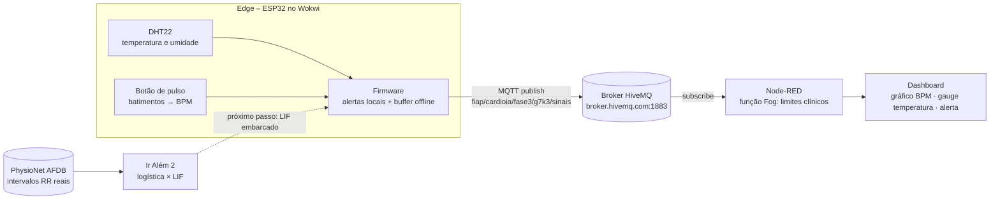
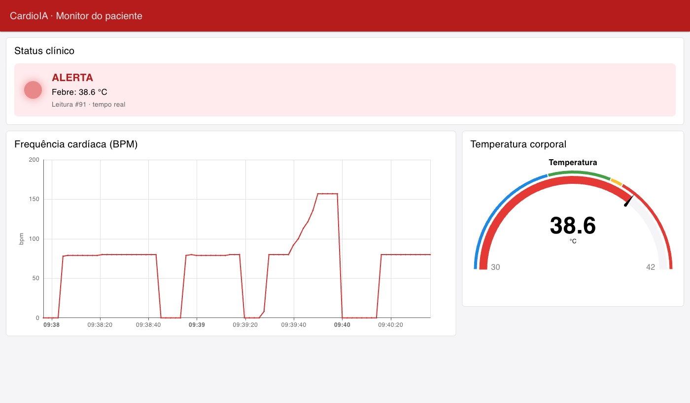

# CardioIA – Fase 3: Monitoramento Contínuo com IoT na Saúde

Protótipo de um **wearable cardíaco** que cobre o ciclo completo de dados em IoT aplicado à saúde: **captura → processamento local → transmissão → visualização → alerta**. O projeto tem três partes:

| Parte | Tema | Pasta | Simulação |
|---|---|---|---|
| **Parte 1** | Armazenamento e processamento local (Edge Computing) | [`parte1/`](parte1/) | [Wokwi – Parte 1](https://wokwi.com/projects/479719847288354817) |
| **Parte 2** | Transmissão MQTT e dashboard no Node-RED (Fog/Cloud Computing) | [`parte2/`](parte2/) | [Wokwi – Parte 2](https://wokwi.com/projects/479763582180327425) |
| **Ir Além 2** | IA em séries temporais: regressão logística × rede neuromórfica LIF | [`ir_alem2/`](ir_alem2/) | Notebook Python |

> 🎥 **Vídeo do Ir Além 2 (YouTube, não listado):** *(adicionar o link após a publicação)*

## Integrantes do grupo

- *(nome – RM)*
- *(nome – RM)*

## Arquitetura



- **Parte 1:** o ESP32 trabalha sozinho e a "nuvem" é o Monitor Serial.
- **Parte 2:** o mesmo dispositivo passa a publicar num broker MQTT real. O ESP32 e o Node-RED nunca se conectam diretamente: o ESP32 **publica** no tópico e o Node-RED **assina** o mesmo tópico.
- **Ir Além 2:** análise separada, com dados clínicos reais. Ele mostra como detectar fibrilação atrial a partir dos instantes de batimento, que é a mesma informação que o botão de pulso do wearable já registra.

## Parte 1 – Edge Computing

**Circuito:** ESP32 com **DHT22** (GPIO 15) e **botão de pulso** (GPIO 4, cada clique = 1 batimento), mais uma chave deslizante (GPIO 27) que simula a conectividade Wi-Fi (variável booleana `wifiConectado`). O LED verde indica online e o vermelho indica alerta clínico.

- **Processamento local:** cada leitura é classificada no próprio dispositivo (febre ≥ 38 °C, hipotermia < 35 °C, taquicardia > 120 bpm, bradicardia < 50 bpm, sem pulso, falha do sensor). O LED de alerta acende **mesmo offline**.
- **Resiliência offline:** toda leitura entra primeiro num buffer circular em RAM. Quando a rede volta, o backlog é enviado em ordem (`Serial.println`) e o armazenamento local é apagado.
- **Armazenamento limitado:** 2.880 amostras, o que dá 4 h sem rede a 1 amostra a cada 5 s (≈ 46 kB de RAM). Acima de 80% de ocupação, as amostras normais são decimadas. Com o buffer cheio, a primeira a sair é a amostra normal mais antiga, e os alertas são preservados.
- **SPIFFS (opcional):** fica implementado atrás da constante `USE_SPIFFS`, para uso em chip real.

📄 [Relatório da Parte 1](parte1/RELATORIO_PARTE1.pdf) · 💻 [`sketch.ino`](parte1/sketch.ino)

## Parte 2 – MQTT, Fog e Dashboard

- **ESP32 → broker:** a biblioteca PubSubClient publica cada leitura como JSON (`seq`, `t_ms`, `envio_ms`, `temp`, `umid`, `bpm`, `alerta`) em `broker.hivemq.com`. A reconexão roda numa tarefa FreeRTOS separada, para que a coleta não pare enquanto o broker estiver fora do ar.
- **Queda de rede:** a chave em OFF derruba a sessão MQTT e as leituras se acumulam no buffer. Em ON, o backlog é publicado em ordem, sem perda.
- **Node-RED (Fog):** reaplica os limites clínicos e reposiciona cada leitura atrasada no horário em que foi medida (`envio_ms − t_ms`).
- **Dashboard 2.0:** gráfico de BPM em tempo real, gauge de temperatura (30–42 °C) e indicador de alerta com LED virtual e texto.



📄 [Relatório da Parte 2](parte2/RELATORIO_PARTE2.pdf) · 💻 [`sketch.ino`](parte2/sketch.ino) · 🔀 [`flows.json`](parte2/flows.json) · 🖼️ [prints](parte2/prints/)

### Como testar o fluxo completo

1. Instale e inicie o Node-RED com o Dashboard 2.0:
   ```bash
   npm install -g node-red
   cd ~/.node-red && npm install @flowfuse/node-red-dashboard
   node-red
   ```
2. Em http://localhost:1880, vá em **Menu → Importar**, selecione [`parte2/flows.json`](parte2/flows.json) e clique em **Implementar**.
3. Abra o dashboard em http://localhost:1880/dashboard/monitor.
4. Abra o [projeto da Parte 2 no Wokwi](https://wokwi.com/projects/479763582180327425) e clique no ▶. **Mantenha a aba visível**: em segundo plano o navegador desacelera a simulação e o broker encerra a sessão.
5. Teste os cenários:

| Ação no Wokwi | Resultado no dashboard |
|---|---|
| Clicar no botão **PULSO** ~1×/s | Indicador verde, ~60–80 bpm no gráfico |
| Clicar rápido (~3×/s) por 15 s | Alerta de taquicardia |
| Clicar no DHT22 e subir para 38,5 °C | Alerta de febre, gauge na faixa vermelha |
| Chave em OFF por ~20 s e depois ON | O buffer cresce no serial; na volta, o gráfico preenche o intervalo |

## Ir Além 2 – Fibrilação atrial: regressão logística × rede LIF

Detecção de **fibrilação atrial** a partir dos **intervalos RR** de 25 pacientes da *MIT-BIH Atrial Fibrillation Database* (PhysioNet). A avaliação é **por paciente**: os pacientes de teste nunca aparecem no treino.

| Modelo | AUC | Acurácia balanceada | Sensibilidade | Especificidade |
|---|---|---|---|---|
| Regressão logística (7 medidas HRV) | 0,975 ± 0,031 | 0,951 ± 0,040 | 0,974 ± 0,017 | 0,927 ± 0,089 |
| Rede LIF (codificador de eventos + 1 neurônio) | 0,979 ± 0,016 | 0,959 ± 0,024 | 0,973 ± 0,028 | 0,945 ± 0,054 |

O resultado é um **empate técnico**. A diferença está no custo: a rede LIF usa 4 parâmetros, 12 bytes de estado e cerca de 6 operações por batimento, o que caberia no próprio ESP32. A principal limitação, comum aos dois modelos, é que extrassístoles frequentes imitam a irregularidade da FA.

📓 [Notebook](ir_alem2/CardioIA_FA_LIF_vs_Logistica.ipynb) · 📄 [Relatório comparativo](ir_alem2/RELATORIO_IR_ALEM2.pdf) · 📘 [README do Ir Além 2](ir_alem2/README.md) (inclui como executar)

## Estrutura do repositório

```
├── parte1/                      Edge Computing
│   ├── sketch.ino               firmware ESP32 comentado
│   ├── diagram.json             circuito do Wokwi
│   ├── libraries.txt            bibliotecas do Wokwi
│   └── RELATORIO_PARTE1.pdf     fluxo de funcionamento e lógica de resiliência
├── parte2/                      Fog/Cloud Computing
│   ├── sketch.ino               firmware ESP32 com MQTT
│   ├── diagram.json · libraries.txt
│   ├── flows.json               fluxo e dashboard do Node-RED
│   ├── prints/                  evidências (dashboard, Wokwi, log serial)
│   └── RELATORIO_PARTE2.pdf     fluxo MQTT e configuração do dashboard
└── ir_alem2/                    IA em séries temporais
    ├── CardioIA_FA_LIF_vs_Logistica.ipynb
    ├── figuras/ · requirements.txt · README.md
    └── RELATORIO_IR_ALEM2.pdf   relatório comparativo
```

## Tecnologias

ESP32 · Wokwi · C++/Arduino · DHT22 · MQTT (PubSubClient, HiveMQ) · FreeRTOS · Node-RED 5 + Dashboard 2.0 · Python 3.12 · scikit-learn · NumPy · pandas · Matplotlib · wfdb (PhysioNet)

## Segurança e privacidade

O broker público usado na demonstração não tem autenticação nem criptografia, e só é adequado para **dados simulados**. Para dados reais de pacientes, que a LGPD trata como dados pessoais sensíveis, o projeto exigiria:
- broker privado com TLS (porta 8883) e credencial por dispositivo;
- controle de acesso por tópico;
- credenciais fora do código;
- identificação pseudonimizada do paciente;
- autenticação no Node-RED.

Os detalhes estão no [relatório da Parte 2](parte2/RELATORIO_PARTE2.pdf).
