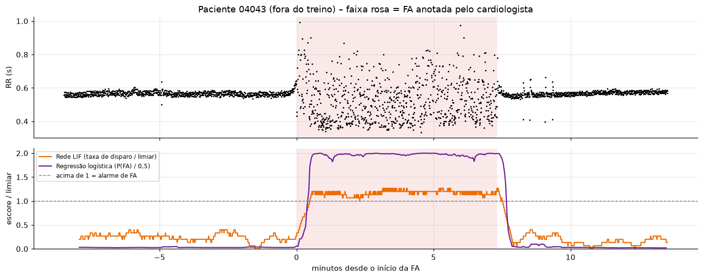
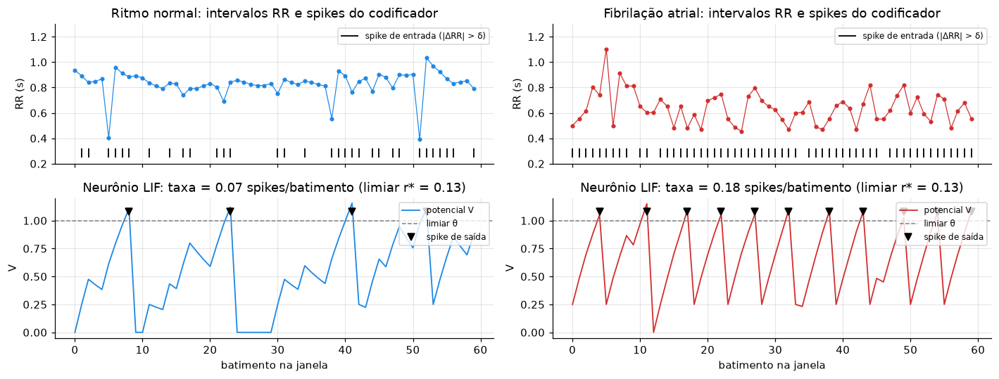

# CardioIA – Fase 3 · Ir Além 2

## Detecção de fibrilação atrial: regressão logística × rede neuromórfica LIF

Este trabalho compara um classificador tradicional (**regressão logística**) com uma **rede neuromórfica simples baseada no neurônio LIF** (*Leaky Integrate-and-Fire*) na detecção de **fibrilação atrial (FA)** a partir da série de **intervalos entre batimentos** (intervalos RR). Essa é a mesma informação que o wearable do CardioIA já registra nas Partes 1 e 2, a cada clique do botão de pulso.

> 🎥 **Vídeo de apresentação (YouTube, não listado):** *(adicionar o link após a publicação)*

## Resultados

Validação cruzada **por paciente** (5 rodadas; os pacientes de teste nunca aparecem no treino), com janelas de 60 batimentos (≈ 45 s):

| Modelo | AUC | Acurácia balanceada | Sensibilidade | Especificidade |
|---|---|---|---|---|
| Regressão logística (7 medidas de variabilidade) | 0,975 ± 0,031 | 0,951 ± 0,040 | 0,974 ± 0,017 | 0,927 ± 0,089 |
| Rede LIF (codificador de eventos + 1 neurônio) | 0,979 ± 0,016 | 0,959 ± 0,024 | 0,973 ± 0,028 | 0,945 ± 0,054 |

- **Empate técnico.** As diferenças são menores que a variação entre rodadas. A rede LIF chega lá com **4 parâmetros e 12 bytes de estado**, processando batimento a batimento.
- **Em fluxo contínuo** (paciente 04043, fora do treino), os dois modelos dão o alarme cerca de 30 s após o início da FA, sem alarmes falsos antes.
- **Limitação principal.** Extrassístoles frequentes (bigeminismo, paciente 08219) imitam a irregularidade da FA e causam alarmes falsos nos dois modelos.



## Como funciona a rede LIF

1. **Codificador de eventos:** a cada batimento, emite um *spike* se o intervalo mudou mais que δ (≈ 3%) em relação ao anterior.
2. **Neurônio LIF:** integra esses spikes com peso *w*, e o potencial vaza com constante de tempo τ (4–8 s). Entre batimentos, o decaimento `e^(−RR/τ)` é a solução exata da equação do LIF, então o cálculo só acontece quando há batimento. Ao passar do limiar, o neurônio dispara e reinicia.
3. **Decisão:** a janela é classificada como FA se a **taxa de disparo** passar de um limiar r*, calibrado no treino.



## Estrutura

| Arquivo | Conteúdo |
|---|---|
| `CardioIA_FA_LIF_vs_Logistica.ipynb` | Notebook comentado e já executado: dados, modelos, avaliação, eficiência, demonstração e conclusões |
| `RELATORIO_IR_ALEM2.pdf` | Relatório comparativo (2 páginas) |
| `figuras/` | Figuras geradas pelo notebook |
| `requirements.txt` | Dependências (Python 3.12) |
| `dados/afdb/` | Criada na primeira execução: anotações baixadas da PhysioNet (~2,6 MB) |

## Como executar

Requer Python 3.12 e internet na primeira execução, para baixar os dados.

```bash
python3.12 -m venv .venv && source .venv/bin/activate
pip install -r requirements.txt
jupyter nbconvert --to notebook --execute --inplace CardioIA_FA_LIF_vs_Logistica.ipynb
```

Também dá para abrir o notebook no VS Code ou no Jupyter e executar as células em ordem. A execução completa leva cerca de 1 minuto.

## Dados e créditos

*MIT-BIH Atrial Fibrillation Database*, disponível na [PhysioNet](https://physionet.org/content/afdb/) sob a licença ODC-By. São 25 pacientes, cerca de 10 h de Holter cada, com episódios de FA anotados por cardiologistas. O notebook usa apenas as anotações de batimentos (`.qrs`) e de ritmo (`.atr`).

- Moody GB, Mark RG. *A new method for detecting atrial fibrillation using R-R intervals.* Computers in Cardiology 10:227-230 (1983).
- Goldberger AL et al. *PhysioBank, PhysioToolkit, and PhysioNet.* Circulation 101(23):e215-e220 (2000).
