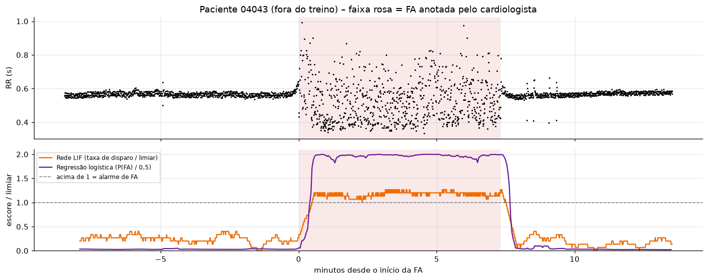

# 1. Problema e dados

A **fibrilação atrial (FA)** é a arritmia sustentada mais comum e muitas vezes não dá sintomas. Na FA, a frequência pode estar "normal", mas os batimentos ficam **irregulares**. Por isso uma regra de limite (como o alerta de taquicardia > 120 bpm das Partes 1 e 2) não a detecta. O objetivo foi reconhecer a FA apenas pela série de **intervalos RR** (tempo entre batimentos), que é a informação que o wearable do CardioIA já registra a cada clique do botão de pulso.

Usamos a *MIT-BIH Atrial Fibrillation Database* (PhysioNet): 25 pacientes, cerca de 10 h de Holter cada, com 149 h de ritmo normal e 93 h de FA anotadas por cardiologistas. A série foi dividida em **18.593 janelas de 60 batimentos** (≈ 45 s; 43% FA). Foram descartadas janelas com transição de ritmo, flutter, ritmo juncional ou RR fora de 0,25–2,5 s (artefatos).

# 2. Modelos comparados

| | Regressão logística | Rede neuromórfica LIF |
|--|----------|----------|
| Entrada | 7 medidas de variabilidade por janela (RR médio, SDNN, RMSSD, pNN50, CV e normalizações) | Série RR batimento a batimento |
| Estrutura | Padronização + regressão logística com classes balanceadas | Codificador de eventos (spike se \|ΔRR\|/RR > δ) → neurônio LIF com vazamento exato $e^{-RR/\tau}$, peso *w* e limiar θ = 1 |
| Decisão | P(FA) ≥ 0,5 | taxa de disparo ≥ r* |
| Treino | máxima verossimilhança (gradiente) | busca em grade de δ, τ, w e r* (sem gradiente) |
| Parâmetros | 22 (7 pesos, viés e padronização) | 4 |

**Validação:** `GroupKFold` com 5 rodadas **agrupadas por paciente**, ou seja, os pacientes de teste nunca aparecem no treino. Sorteio aleatório de janelas inflaria o resultado, porque janelas do mesmo paciente são muito parecidas. Toda calibração usa só o treino de cada rodada.

# 3. Resultados

| Modelo | AUC | Acurácia balanceada | Sensibilidade | Especificidade | F1 |
|---|---|---|---|---|---|
| Regressão logística | 0,975 ± 0,031 | 0,951 ± 0,040 | 0,974 ± 0,017 | 0,927 ± 0,089 | 0,932 ± 0,075 |
| **Rede LIF** | **0,979 ± 0,016** | **0,959 ± 0,024** | 0,973 ± 0,028 | **0,945 ± 0,054** | **0,944 ± 0,050** |

*Média ± desvio padrão entre as 5 rodadas por paciente.*

- **Empate técnico:** as diferenças (≤ 0,02) são menores que a variação entre rodadas. Com 25 pacientes, não é possível afirmar superioridade de nenhum dos dois. A rede LIF foi mais **estável** entre rodadas e teve menos alarmes falsos em média.
- **Calibração estável do LIF:** δ = 0,03 (3% de variação) em todas as rodadas; τ entre 4 e 8 s.
- **Tamanho da janela:** passar de 30 para 120 batimentos melhora pouco a acurácia balanceada (LIF 0,952 → 0,962; logística 0,951 → 0,960), à custa de dobrar ou quadruplicar o atraso.
- **Fluxo contínuo:** no paciente 04043 (fora do treino), os dois modelos dão o alarme cerca de 30 s após o início da FA (LIF 29 s, logística 27 s), sem alarmes falsos antes (figura).

{width=88%}

# 4. Análise comparativa

| | Regressão logística | Rede LIF |
|--|----------|----------|
| **Vantagens** | Treino padrão e rápido; saída probabilística, com margem larga (P ≈ 1 na FA); fácil incluir novas medidas | Processa em fluxo, de forma causal, com 12 bytes de estado (contra 240 bytes de buffer da logística); ≈ 6 operações por batimento (contra ≈ 13); orientada a eventos e esparsa (em ritmo normal, ~15 spikes de entrada e < 2 de saída a cada 60 batimentos); parâmetros com significado físico |
| **Limitações** | Depende de engenharia de atributos e da janela completa; coeficientes enganosos por multicolinearidade (o RMSSD normalizado recebe peso negativo, embora seja maior na FA); menos estável entre pacientes (especificidade ± 0,089) | Sem gradiente: a busca em grade não escala para redes maiores (exigiria *surrogate gradients*); margem de decisão estreita (taxa só 10–20% acima do limiar na FA); enxerga um único aspecto do sinal |

**Limitação comum.** As **extrassístoles** imitam a FA. No paciente 08219, que tem bigeminismo (RR alternando entre 0,35 s e 0,65 s), os dois modelos ficaram em alarme falso durante quase todo o ritmo normal (LIF 77% do tempo, logística 92%). Esse foi o paciente com mais erros (31% no LIF, 48% na logística). Só com intervalos RR não há como separar esses casos; isso exigiria a onda P do ECG ou um detector de padrões alternados.

**Validade.** A base tem 25 pacientes e é de 1983 (Holter de ECG, não pulso óptico de relógio), e as transições foram excluídas da avaliação por janelas. Os resultados indicam viabilidade, não desempenho clínico.

# 5. Conclusão

Uma rede neuromórfica mínima (**um codificador de eventos e um único neurônio LIF, com 4 parâmetros**) alcançou o mesmo desempenho de uma regressão logística com engenharia de atributos na detecção de FA por intervalos RR, com AUC de cerca de 0,98 em pacientes nunca vistos. A diferença real entre os dois está no **custo**: a rede LIF processa cada batimento com poucas operações, sem buffer, e só trabalha quando há evento. Isso a torna adequada para rodar no próprio ESP32 do CardioIA ou em hardware neuromórfico. O próximo passo natural é embarcá-la no firmware das Partes 1 e 2, alimentada pelos instantes de batimento já registrados, e publicar o escore de FA no mesmo tópico MQTT, levando o alerta de arritmia para a borda.

*Código, notebook e figuras: `CardioIA_FA_LIF_vs_Logistica.ipynb`. Dados: PhysioNet AFDB (Moody & Mark, 1983; Goldberger et al., 2000).*
