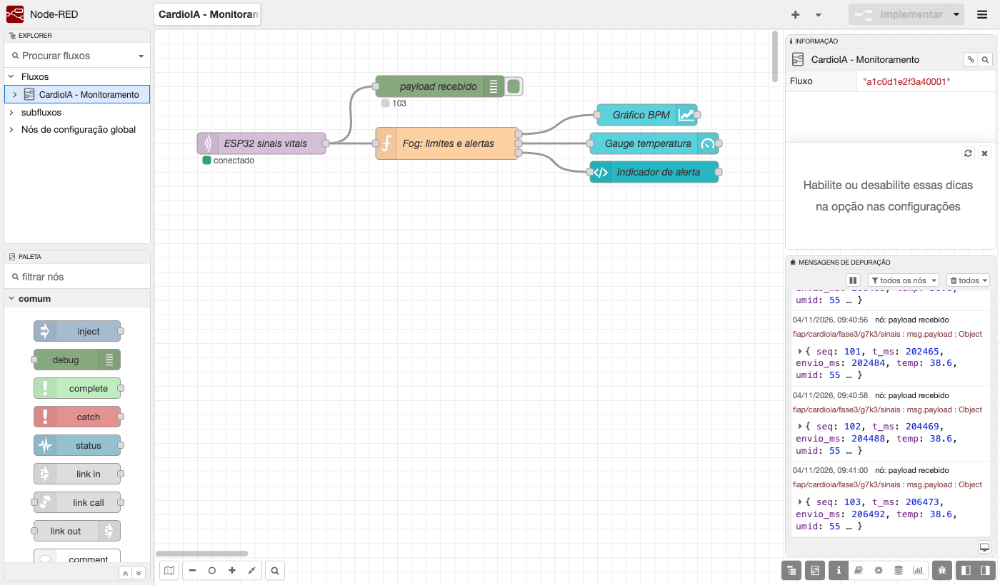
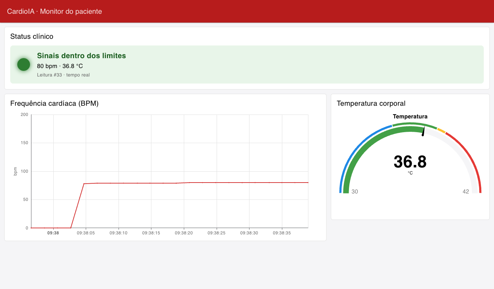
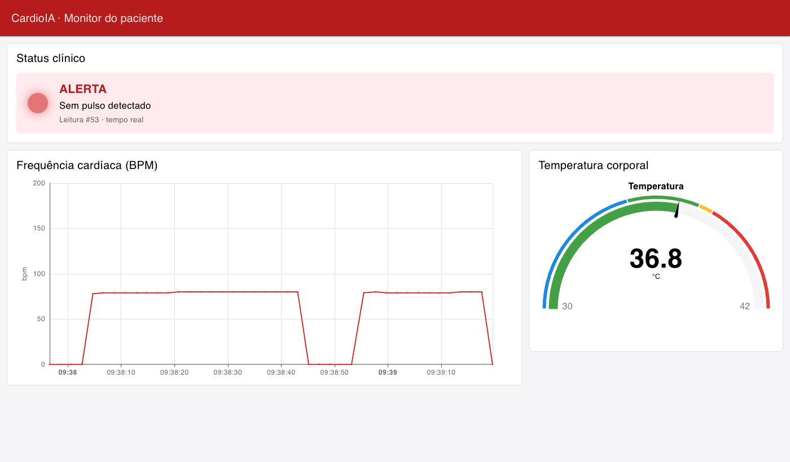

# 1. Visão geral

A Parte 1 deixou o wearable coletando sinais vitais, classificando riscos e guardando as leituras localmente quando não há rede. Na Parte 2, a "nuvem" deixa de ser simulada por `Serial.println`: o ESP32 publica cada leitura num **broker MQTT real**, um servidor **Node-RED** assina esse tópico, reavalia os limites clínicos (camada Fog) e alimenta um **dashboard** com gráfico, medidor e alerta.

| Camada | Componente | Papel |
|---|---|---|
| **Edge** | ESP32 no Wokwi (DHT22 + botão de pulso) | Coleta, alerta local (LED), buffer offline e publicação MQTT |
| **Cloud** | Broker público HiveMQ (`broker.hivemq.com:1883`) | Recebe as publicações e distribui para os assinantes |
| **Fog** | Node-RED 5 (local) | Assina o tópico, reaplica os limites e decide o alerta |
| **Visualização** | Node-RED Dashboard 2.0 | Gráfico de BPM, medidor de temperatura e indicador de alerta |

O circuito é o mesmo da Parte 1 (`diagram.json`). Os arquivos desta parte são `sketch.ino` (firmware), `libraries.txt` (*DHT sensor library for ESPx* e *PubSubClient*), `flows.json` (fluxo exportado do Node-RED) e a pasta `prints/` com as evidências e o log serial completo do teste (`serial_wokwi.txt`).

# 2. Fluxo de comunicação MQTT

**Caminho de uma leitura.**

> ESP32 → `publish` no tópico `fiap/cardioia/fase3/g7k3/sinais` → broker HiveMQ → Node-RED (`mqtt in`, *subscribe*) → função Fog → widgets do dashboard

## 2.1 Conexão

O firmware conecta no Wi-Fi do simulador (`Wokwi-GUEST`) e usa a biblioteca **PubSubClient** para falar MQTT 3.1.1 com o broker. Cada sessão usa um *client ID* aleatório (`cardioia-xxxxxxxx`), porque o broker é público e dois clientes com o mesmo ID derrubam um ao outro.

A reconexão é tentada a cada 5 s e roda numa **tarefa separada do FreeRTOS**. Esse detalhe surgiu nos testes: na primeira versão, `mqtt.connect()` rodava dentro do `loop()` e, quando o broker ficava inacessível, cada tentativa travava o laço por cerca de 10 s, o que interrompia a coleta. Com a conexão em outra tarefa, o `loop()` continua lendo os sensores enquanto a conexão é negociada. No log, as leituras #3 e #4 aparecem entre a mensagem "Conectando..." e "ONLINE".

## 2.2 Tópico e payload

O tópico segue uma hierarquia `organização/projeto/fase/grupo/recurso`. Isso facilita filtros com curinga (por exemplo, `fiap/cardioia/+/+/sinais`) e o controle de acesso por tópico num broker privado. O sufixo `g7k3` evita colisão com outros grupos no broker público.

Cada leitura vira um JSON de cerca de 100 bytes:

`{"seq":41,"t_ms":82187,"envio_ms":99341,"temp":36.8,"umid":55,"bpm":79,"alerta":0}`

| Campo | Significado |
|---|---|
| `seq` | Número sequencial da amostra. Lacunas indicam perda ou descarte |
| `t_ms` | Instante da coleta, em ms desde o boot do ESP32 |
| `envio_ms` | Instante do envio. A diferença `envio_ms − t_ms` é o atraso causado pelo modo offline |
| `temp`, `umid` | Temperatura (°C) e umidade (%) do DHT22 |
| `bpm` | Frequência cardíaca calculada a partir do botão de pulso |
| `alerta` | *Bitmask* calculado na borda (1 febre, 2 hipotermia, 4 taquicardia, 8 bradicardia, 16 sem pulso, 32 falha do sensor) |

## 2.3 Qualidade de serviço e garantia de entrega

A PubSubClient publica com **QoS 0**, sem confirmação do broker. A garantia de não perder dados fica na aplicação: a amostra só sai do buffer local quando `publish()` retorna sucesso. Se a conexão cair no meio da sincronização, o envio para e o restante continua na fila. O campo `seq` permite que o lado da nuvem audite lacunas. Num produto real, o passo seguinte seria usar QoS 1 (com confirmação PUBACK) por meio de um cliente que o suporte na publicação, como o `esp-mqtt` do ESP-IDF.

## 2.4 Queda de rede e sincronização

A chave deslizante continua simulando a conectividade. Em **OFF**, o firmware encerra a sessão MQTT, o LED verde apaga e as leituras se acumulam no buffer circular (até 2.880 amostras, conforme o dimensionamento da Parte 1). Em **ON**, o ESP32 reconecta e publica o atraso em ordem cronológica, em lotes de 20 por ciclo, para não travar a coleta.

No teste registrado em `prints/serial_wokwi.txt`, as leituras **#41 a #49** foram coletadas offline (buffer chegou a 9/2880). Logo após a reconexão, foram publicadas em sequência, com até 17 s de atraso (`envio_ms − t_ms`), e o buffer local foi zerado.

O Node-RED usa esse atraso para **reposicionar cada ponto no horário em que foi medido** (`ts = agora − (envio_ms − t_ms)`). Assim, o gráfico não "empilha" o atraso no momento da reconexão: o trecho offline aparece contínuo, no horário correto (Figura 3).

# 3. Configuração do Node-RED e do dashboard

## 3.1 Fluxo

| Nó | Tipo | Configuração |
|---|---|---|
| ESP32 sinais vitais | `mqtt in` | Broker `broker.hivemq.com:1883`, tópico do grupo, QoS 0, saída *JSON* (objeto já convertido) |
| payload recebido | `debug` | Mostra cada mensagem e o `seq` no status do nó (evidência de recebimento) |
| Fog: limites e alertas | `function` (3 saídas) | Reaplica os limites, reconstrói o horário da leitura e monta as mensagens dos widgets |
| Gráfico BPM | `ui-chart` | Linha; eixo X = `msg.ts` (horário da coleta); eixo Y 0–200 bpm; janela de 10 min |
| Gauge temperatura | `ui-gauge` | Meia-lua, 30–42 °C; faixas azul (< 35), verde (35–37,5), amarela (37,5–38) e vermelha (≥ 38) |
| Indicador de alerta | `ui-template` | "LED" virtual verde ou vermelho piscante, texto com os alertas ativos e o número da leitura |

## 3.2 Lógica Fog (limites definidos pelo grupo)

A função não confia cegamente no *bitmask* do dispositivo. Ela recalcula os alertas a partir dos valores brutos, com os mesmos limites do firmware. Isso dá uma segunda checagem independente e permite ajustar limites na camada Fog sem regravar o ESP32. A única informação usada do *bitmask* é a falha do sensor (bit 32), porque o valor de temperatura enviado nesse caso não é uma medição.

| Condição | Limite | Mensagem no painel |
|---|---|---|
| Febre | T ≥ 38,0 °C | "Febre: 38.6 °C" |
| Hipotermia | T < 35,0 °C | "Hipotermia: …" |
| Taquicardia | BPM > 120 | "Taquicardia: 157 bpm" |
| Bradicardia | 0 < BPM < 50 | "Bradicardia: …" |
| Sem pulso | BPM = 0 | "Sem pulso detectado" |
| Falha do sensor | bit 32 do `alerta` | "Falha no sensor de temperatura" |

Quando há mais de um alerta, eles aparecem juntos (por exemplo, "Febre · Taquicardia"). A saída de temperatura é suprimida em caso de falha do sensor, para o medidor não exibir um valor falso.

## 3.3 Dashboard em funcionamento

O dashboard fica em `http://localhost:1880/dashboard/monitor`, numa página com três grupos: **Status clínico** (indicador de alerta), **Frequência cardíaca** (gráfico) e **Temperatura corporal** (medidor).

As demais evidências estão em `prints/`: o simulador online (02), offline com buffer crescendo (03), a sincronização (04), o alerta de taquicardia (06) e os LEDs de alerta no próprio dispositivo (07 e 09).

# 4. Segurança, privacidade e eficiência

**O que foi feito aqui é adequado só para dados simulados.** O broker público não tem autenticação nem criptografia: qualquer pessoa que assine o tópico lê as mensagens. Para dados reais de pacientes, que a LGPD trata como **dados pessoais sensíveis**, a configuração mínima seria:

- broker privado (por exemplo, HiveMQ Cloud) com **TLS na porta 8883** e **usuário e senha por dispositivo**;
- **ACL por tópico**, para que cada dispositivo só publique no próprio tópico e o Node-RED só leia o que precisa;
- credenciais fora do código-fonte (provisionadas no dispositivo), já que o repositório é público;
- **identificador pseudonimizado** do paciente no tópico e no payload, nunca nome ou CPF;
- autenticação no editor do Node-RED (`adminAuth`) e no dashboard, que hoje ficam abertos na rede local.

**Eficiência.** O payload tem cerca de 100 bytes a cada 2 s (5 s em produção), o que dá menos de 0,1 kB/s por paciente. O MQTT mantém uma única conexão TCP aberta, com cabeçalho fixo de apenas 2 bytes por mensagem (mais o nome do tópico), bem mais leve que uma requisição HTTP por leitura. O alerta crítico continua sendo decidido na borda (LED do dispositivo), sem depender da rede. O Fog serve para consolidar a informação e exibi-la à equipe.

# 5. Como reproduzir

1. Instale o Node-RED e o Dashboard 2.0:
   `npm install -g node-red` e depois `cd ~/.node-red && npm install @flowfuse/node-red-dashboard`.
2. Rode `node-red`, abra `http://localhost:1880`, vá em **Menu → Importar** e selecione `flows.json`. Clique em **Implementar**.
3. Abra o projeto da Parte 2 no Wokwi (link abaixo), que já tem o circuito, o `sketch.ino` e o `libraries.txt` desta parte. Inicie a simulação e **mantenha a aba visível**: o navegador desacelera abas em segundo plano, e com o ESP32 lento o broker encerra a sessão por falta de *keep-alive*.
4. Abra `http://localhost:1880/dashboard/monitor` e clique no botão **PULSO** cerca de 1 vez por segundo (≈ 80 bpm).
5. Teste os alertas: clique rápido (≈ 3 cliques/s) para taquicardia; clique no DHT22 durante a simulação e suba a temperatura para 38,5 °C para febre.
6. Teste a resiliência: coloque a chave em OFF por alguns segundos (o LED verde apaga e o `buffer=` cresce) e depois volte para ON. O log mostra `Sincronizando backlog`, e o gráfico preenche o intervalo.

**Link do projeto no Wokwi:** <https://wokwi.com/projects/479763582180327425>
